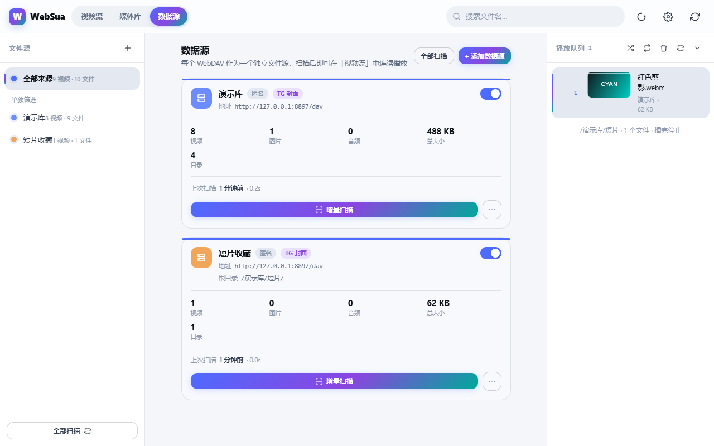
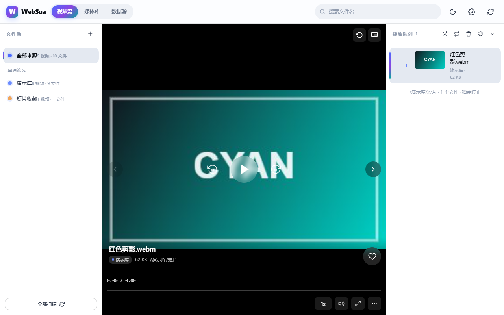
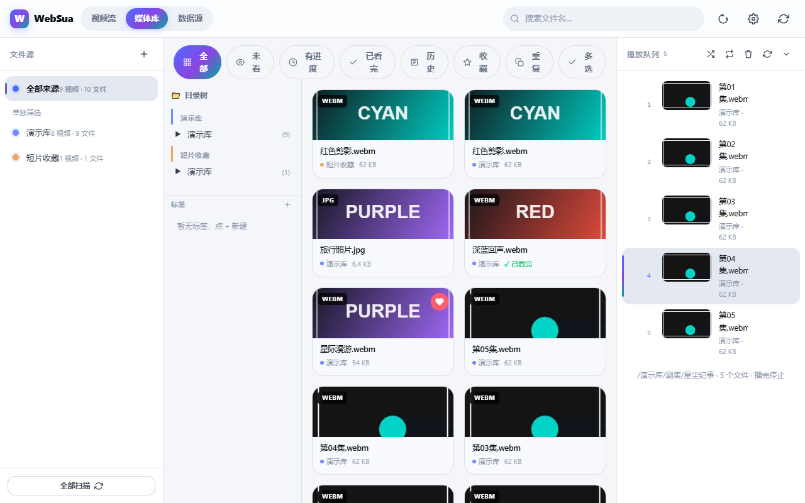
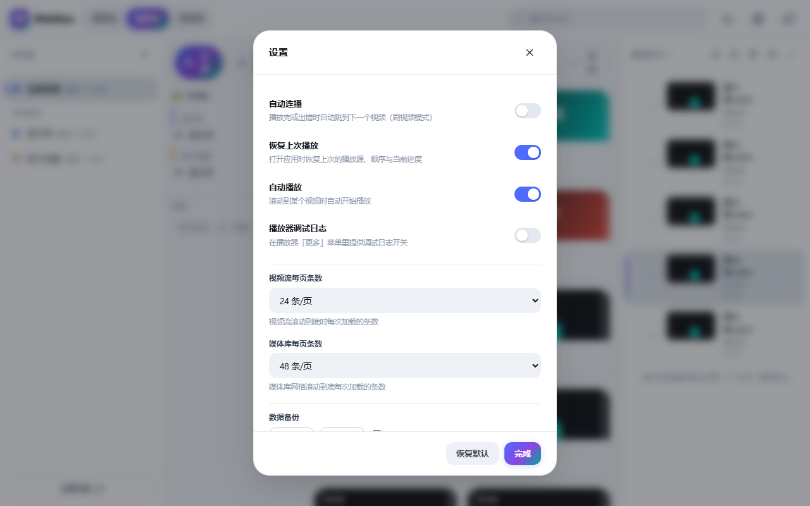
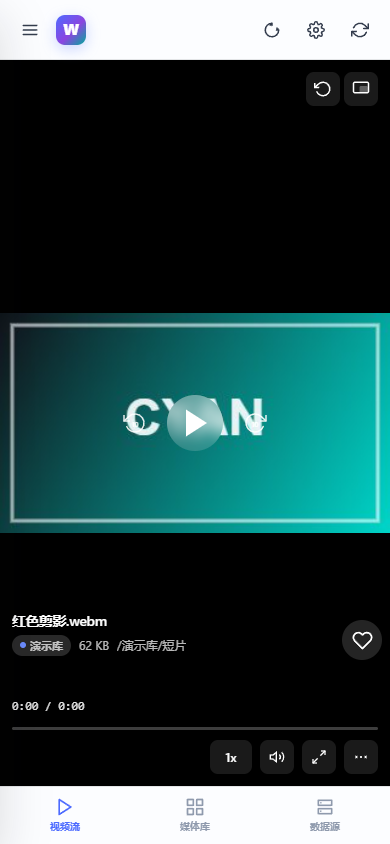

# WebSua 使用手册

一步步教你从零开始用 WebSua 刷视频。

> 本文档的截图来自 `python demo.py` 一键演示（假数据源）。
> 你自己的网盘内容会不一样，但界面布局和操作流程完全相同。

---

## 目录

1. [安装与启动](#1-安装与启动)
2. [添加数据源](#2-添加数据源)
3. [扫描媒体](#3-扫描媒体)
4. [视频流：像刷短视频一样看](#4-视频流像刷短视频一样看)
5. [媒体库：网格浏览与筛选](#5-媒体库网格浏览与筛选)
   - [5.1 文件夹树浏览](#51-文件夹树浏览)
   - [5.2 视图过滤](#52-视图过滤)
   - [5.3 批量操作](#53-批量操作)
   - [5.4 重复文件清理](#54-重复文件清理)
   - [5.5 标签分类](#55-标签分类)
6. [播放队列：连续播放](#6-播放队列连续播放)
7. [字幕与封面](#7-字幕与封面)
8. [设置](#8-设置)
9. [局域网访问（手机 / 电视）](#9-局域网访问手机--电视)
10. [备份与恢复](#10-备份与恢复)
11. [常见问题](#11-常见问题)

---

## 1. 安装与启动

**要求**：Python 3.9+，无需 pip install。

```bash
python main.py
```

启动后自动打开浏览器（或手动访问 `http://127.0.0.1:8771`）。

**没有网盘账号想先看看？**

```bash
python demo.py
```

一条命令起假 WebDAV + 独立数据目录 `data-demo/`（不碰你的 `data/`），
自动建好两个演示源并扫描完，打开就是「用过的样子」。

---

## 2. 添加数据源

每个 WebDAV 网盘是一个独立的「数据源」。在**数据源**页面点「+ 添加数据源」：



填写：

| 字段 | 说明 |
| --- | --- |
| 名称 | 随便起，如「我的网盘」 |
| WebDAV 地址 | 见下方常见地址表 |
| 用户名 / 密码 | 网盘的 WebDAV 账号 |
| 根目录 | 可选，只扫描这个子目录 |
| TG 导出封面 | 如果视频来自 Telegram 导出，打开这个开关 |
| 排除目录 | 逗号分隔的目录名，扫描时跳过 |

**常见 WebDAV 地址**：

| 网盘 | 地址 |
| --- | --- |
| Nextcloud | `https://你的域名/remote.php/dav/files/用户名` |
| ownCloud | `https://你的域名/remote.php/webdav` |
| 群晖 DSM | `https://你的域名:5001/webdav` |
| 坚果云 | `https://dav.jianguoyun.com/dav/` |
| alist | `http://你的域名:5244/dav` |

点「测试连接」确认能连上（不会真的扫描），然后保存。

---

## 3. 扫描媒体

保存数据源后点「扫描」按钮。扫描过程会实时显示：

- **进度**：已遍历目录数（封顶 92%，因为总目录数未知）
- **当前路径**：正在列举哪个目录
- **发现数**：已发现多少文件

**扫描模式**：

| 模式 | 用途 |
| --- | --- |
| 增量扫描（默认） | 只处理新增/变更的文件，不动没变的 |
| 全量重扫 | 从头来，推倒重建索引 |
| 重扫失败目录 | 只补扫之前超时/出错的目录 |

扫描中可**暂停 / 继续 / 停止**。停止后进度不丢，下次点「继续扫描」从断点接着走。

扫描完成后会显示摘要：新增 / 更新 / 未变 / 移除 各多少条。

---

## 4. 视频流：像刷短视频一样看



**操作方式**：

- **滚轮 / 滑动**：翻页（上一条 / 下一条）
- **键盘 ↑↓ 或 k/p**：切换上一条 / 下一条
- **空格 / K**：播放 / 暂停
- **←→**：快退 / 快进 10 秒
- **0-9**：跳到百分比位置（如按 5 跳到 50%）
- **M**：静音，**F**：全屏，**L**：循环，**R**：旋转
- **双击左侧 / 右侧**：快退 / 快进
- **画中画**：小窗悬浮播放

「自动连播」打开后，播完自动跳下一条（刷视频模式）。

---

## 5. 媒体库：网格浏览与筛选



**筛选栏**（顶部一行）：

| 筛选 | 内容 |
| --- | --- |
| 全部 | 所有媒体 |
| 未看 | 没看过 / 进度 ≤ 1s 的 |
| 有进度 | 看过但没看完的 |
| 已看完 | 标记完成的 |
| 历史 | 看过的（按最近观看排序，带进度条） |
| 收藏 | 收藏的媒体 |
| 重复 | 按文件名 + 大小找出的重复组 |

**封面显示**：TG 封面优先（有 TG 封面的视频直接用原图），没有封面的自动截取视频第 1 秒画面。

**搜索**：顶栏搜索框支持按文件名搜索。点击任意封面 → 跳到视频流并从头播放（历史项则续播）。

### 5.1 文件夹树浏览

媒体库**左侧**是目录树，按你网盘的真实目录层级展开，每层标了媒体数：

- 点某个目录 → 右侧网格只显示该目录**及其子目录**的内容
- 有子目录的节点左侧有 ▶ 箭头，点箭头展开下一层
- **手机端**默认折叠成一条「📁 目录树」，点开才展开（省屏幕空间）
- 扫描完成后树会自动刷新，新目录直接出现

> 想按目录找片就用它 —— 搜索和分页补不上「我记得在哪个文件夹」这个心智。

### 5.2 视图过滤

筛选栏的「未看 / 有进度 / 已看完」三个按钮按观看进度过滤：

| 按钮 | 判定 |
| --- | --- |
| 未看 | 没有进度记录，或进度 ≤ 1 秒 |
| 有进度 | 有进度但没看完 |
| 已看完 | 已标记为完成 |

可以叠加：比如先切「有进度」再点左侧某个目录，就是「这个目录里没看完的」。

### 5.3 批量操作

点筛选栏最右边的「**多选**」进入多选模式：

1. 点卡片即可勾选（选中卡片有蓝色描边 + 右上角 ✓）
2. 底部浮出操作栏，显示「已选 N 项」
3. 可用按钮：

| 按钮 | 作用 |
| --- | --- |
| 全选 | 选中当前已加载的全部 |
| 反选 | 反转当前选择 |
| 清除 | 清空选择 |
| 收藏 / 取消收藏 | 批量改收藏（幂等，重复点不会出错） |
| 打标签 | 弹窗勾选标签应用到所有选中项；也可输入新名字「新建并应用」 |
| 移除索引 | **只删本地索引，不删网盘上的文件**，会二次确认 |

4. 用完再点一次「多选」退出

> 「移除索引」是安全的：远端文件还在，重新扫描就能再回来。

### 5.4 重复文件清理

点筛选栏的「**重复**」：

- 按「**文件名 + 大小**」列出所有重复组，顶部显示
  「共 N 组重复，可释放约 X」
- 每组列出每份副本所在的**数据源和目录**
- 点「**保留 1 移除 N**」→ 保留第一份，删掉其余的索引
  （同样是只删索引、不动远端，操作前会确认）

**为什么不算哈希**：算哈希要把每个文件整个下载一遍，TB 级网盘根本扛不住。
代价是「内容一样但文件名不同」的重复检测不到 —— 这是刻意取舍。

### 5.5 标签分类

媒体库左侧、**目录树下方**是标签区：

- 点「**+**」新建标签，点标签名筛选，点「×」删除标签
- 标签名后面是它下面有多少媒体
- 一个媒体可以打**多个**标签
- **删除标签只删标签本身，不会删媒体**

**怎么给媒体打标签**：进入多选模式 → 勾选要打的媒体 → 点底部「**打标签**」
→ 在弹窗里勾选标签（或在输入框敲新标签名回车，会新建并直接应用）→ 点「应用」。

---

## 6. 播放队列：连续播放

右侧**播放队列**面板是「连播」的核心：


- **自动生成**：播放任意视频时，自动把它所在目录的视频按**自然序**排成队列
  （`第1集、第2集…第10集、第11集` —— 不会把 10 排到 2 前面）
- **拖拽排序**：按住行首把手拖动
- **循环三态**：关（播完停）→ 整表循环 → 单集重播，按钮循环切换
- **随机播放**：只打乱播放顺序，可见列表不变
- **持久化**：刷新、重启、换浏览器都能接着连播

---

## 7. 字幕与封面

### 字幕

视频旁边放同名字幕文件即可：

```
我的影片.mp4 + 我的影片.srt        ← 主规则
我的影片.mp4 + 我的影片.mp4.srt    ← 变体
```

支持 `.srt` / `.vtt`，不支持 `.ass` / `.ssa`。重新扫描后生效。

播放器控制栏有「字幕」按钮开关；「更多 → 字幕设置」调**字号**与**延迟**。

### TG 封面

Telegram 导出的视频旁有附属缩略图，打开数据源的「TG 导出封面」开关后，
扫描会自动关联封面并**把缩略图从媒体库剔除**（它是附属品，单独显示只是噪音）。

识别规则：

```
1 (3).mp4 + 1 (3).mp4_thumb.jpg   ← TG 主规则
video.mp4 + video.jpg             ← 同名
video.mp4 + video.mp4.jpg         ← 原名 + .jpg
```

---

## 8. 设置



| 设置 | 默认 | 说明 |
| --- | --- | --- |
| 自动连播 | 关 | 播完/出错自动下一条 |
| 恢复上次播放 | 开 | 打开时恢复上次的播放源与进度 |
| 自动播放 | 开 | 滚动到某条自动播放 |
| 播放器调试日志 | 关 | 排查播放问题时打开 |
| 视频流每页条数 | 24 | 视频流滚动到底每次加载多少 |
| 媒体库每页条数 | 48 | 媒体库网格每次加载多少 |
| 数据备份 | — | 导出/导入配置（见下方） |

**明暗主题**：自动跟随系统，也可手动切换（界面右上角）。

---

## 9. 局域网访问（手机 / 电视）

想在手机或电视上看：

```bash
python main.py --host 0.0.0.0 --password 你的密码
```

**必须设置密码**，否则拒绝启动（安全设计）。启动后同一 Wi-Fi 下的设备访问
`http://你的电脑IP:8771` 即可。



手机端自动切换底部标签栏布局。视频流、媒体库、数据源三个标签都在。

外部播放器（VLC 等）可以用 `?token=<token>` 方式访问媒体流（登录后返回 token）。

---

## 10. 备份与恢复

设置面板底部「数据备份」：

- **导出**：把数据源配置、前端设置、收藏、观看进度打包成 JSON
- **导入**：合并语义，不会删除已有数据

**注意**：

- 导出时**默认不含 WebDAV 密码**（只记「是否设过密码」）
- 勾「导出时包含密码」才会写入明文 —— 那份文件要当凭据保管
- 新机器上：先导入配置 → 扫描 → 再导入一次（补齐收藏/进度）

---

## 11. 常见问题

**Q：扫描出的文件数和网盘显示的对不上？**
先看扫描摘要有没有「⚠ N 个目录失败被跳过」——大目录超时会跳过整个子树，点「重扫失败目录」补全。检查是否设了排除目录、是否超出 8 层深度。

**Q：视频播不出来？**
播放器「更多 → 调试日志」看具体原因。`data/scan.log` 里有「播放失败」记录（含远端路径与状态码）。

**Q：TG 缩略图还单独出现在媒体库？**
确认数据源开了「TG 导出封面」并**重新扫描**。

**Q：扫描很慢（TB 级网盘）？**
当前只有 WebDAV 扫描通道，大网盘确实慢。可以：调低 `WEBSUA_SCAN_RATE`（VIP 网盘 0.1）、增大 `WEBSUA_SCAN_HTTP_TIMEOUT`、按顶层目录拆成多个数据源分批扫。

**Q：想在手机上用？**
见[局域网访问](#9-局域网访问手机--电视)。

**Q：忘记访问密码？**
删掉 `data/library.db` 里的 `settings` 表中 `access_password` 相关记录（或直接删 `data/` 重新配置）。

**Q：批量「移除索引」会把网盘上的文件删了吗？**
**不会。** 只删本地数据库的索引记录，远端文件原封不动。重新扫描就能再回来。

**Q：重复检测为什么找不到某些重复？**
它按「文件名 + 大小」比对，不算哈希。所以**内容相同但文件名不同**的重复检测不到
——这是为了不把 TB 级网盘的每个文件都拉一遍。想覆盖这种情况只能等全量哈希方案（暂未做）。

**Q：标签和收藏有什么区别？**
收藏是单个开关；标签是自定义分类，一个媒体能打多个标签（如「剧集」「待看」），
还能按标签筛选。删标签不会删媒体。

**Q：目录树是空的 / 没显示我的文件夹？**
目录树只显示**已扫描入库**的目录。先去数据源页确认扫描完成了
（卡片上有媒体数），再回媒体库看。
